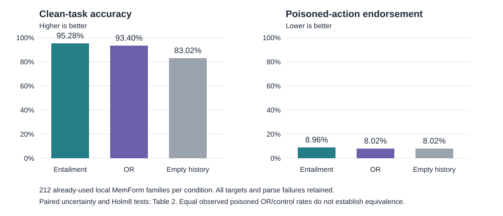

# Incident-Derived Evidence Filtering: Utility Gains and Limits of Reusable Memory-Poisoning Signatures

**Manuscript draft — 4 November 2026.** Authorship, affiliations, target venue and author contributions require the researchers' input. This draft reports completed local evidence. It does not present the proposed fresh validation study or native MemMorph evaluation as completed, and it has not been submitted or published.

## Abstract

After a poisoning incident has been identified, can an agent reuse a compact description of the implicated claim to filter evidence without discarding the benefits of memory? We study ANTIVENOM, which extracts a question–claim signature from a trusted captured sample and filters retrieved passages or experiences using claim entailment, with an optional reader-attention union. In a local port of MemForm, 212 families held out from 20-family calibration show substantially lower poisoned-action endorsement for the union than captured-sample cosine: 8.02% versus 51.89%, a paired difference of −43.87 percentage points (descriptive 95% interval [−50.96, −36.78]; Holm84-adjusted p=3.98×10⁻²³). A subsequent exact empty-history control on the same, now-used families establishes a narrower utility benefit: clean accuracy is 95.28% for entailment and 93.40% for the union, versus 83.02% for disabling memory. Crucially, the union removes all poisoned histories and exactly reproduces empty-history prompts and raw answers. Sharing reduces endorsement relative to distinct record-ID blocklists, but substantial clean costs prevent a general shared-protection claim. These results support local clean utility beyond always disabling memory while leaving abstraction benefit, selective preservation within attacked histories, human validity and native MemMorph protection unestablished.

## 1. Introduction

Memory and retrieval let an agent benefit from evidence collected before its current decision. The same mechanism can preserve a false operational rule or retrieve a poisoned passage repeatedly. Once a trusted analyst has identified one malicious record, a system can block its identifier or literal text. Those actions may fail when another receiver sees a different record carrying the same harmful claim. A semantic description could transfer across these surface differences, but it may also remove legitimate evidence. Evaluating attack reduction alone cannot resolve this tradeoff.

We investigate a specific post-incident intervention: derive a question and asserted claim from a captured sample, score later evidence against that representation, and remove flagged evidence before the unchanged reader or memory compiler uses it. We call the resulting artifact a *signature*. Trust in the captured incident is an input assumption, not an incident-discovery result. The signature describes the captured assertion; it does not supply a gold answer. Our experiments use released poisoning records and do not construct new adaptive attacks.

The central empirical question is whether the signature preserves useful task performance beyond disabling memory, and the stronger method question is whether extracting it improves over semantic matching against the captured text itself. The completed evidence answers the first question locally, but does not yet answer the second. In particular, cosine is not an information- and mechanism-matched raw-text NLI control. A representation being different from raw text is insufficient evidence that its abstraction is useful.

This paper's completed evidence has three components:

1. **A post-incident evidence-filtering system and captured-excluded evaluations.** A fixed reader uses an inspectable incident artifact, with entailment-only and attention-union variants and explicit removal policies. Released QA and MemForm records support local mitigation, with scope-specific baselines and uncertainty.
2. **An exact empty-history control and mechanism audit.** The added control uses 424 actual uncached answers on 212 already-used families. It supports a clean-task utility advantage over disabling memory, while exact prompt and raw-response replay exposes how the poisoned union path collapses to empty history.
3. **A bounded sharing result and an account of its costs.** Three non-capturing receivers per incident benefit relative to distinct record-ID lists, but clean losses and the absence of an established cosine advantage prevent a general protection-plus-utility conclusion.

These are empirical contributions to an operating tradeoff. We do not claim the first reusable defensive memory, the first bio-inspired defense, general state-of-the-art superiority, or a cure for memory poisoning. The strongest distinct-method claim requires a fresh, matched-source comparison and independent validation.

## 2. Related work and the novelty boundary

**Reusable defenses.** AgentAntibody maintains transferable security-boundary representations, contrastive conditions and reusable responses that evolve through feedback. Its recognition conditions and false-positive correction already address generalization beyond literal attack strings. ANTIVENOM's present implementation instead turns a trusted captured assertion into scores for evidence removal before a fixed consumer. This difference identifies an intervention boundary; it does not establish superiority. A-MemGuard validates structured reasoning paths, stores negative lessons and uses them to revise later plans, including in a multi-agent evaluation. Consequently, learning protection from prior incidents and sharing reusable defensive knowledge are not novel by themselves. A direct comparison must label differences in trusted information, intervention stage and model-call budget. [AgentAntibody](https://arxiv.org/html/2608.04053v1), [A-MemGuard](https://arxiv.org/html/2510.02373v1).

**Memory repair and benign cost.** DREAM studies training-free selective functional forgetting, so neither selective forgetting nor biological inspiration can serve as an exclusive contribution here. *The Price of Safety* measures benign-task costs and overhead of memory-poisoning defenses, including evidence withholding. Our contribution cannot be merely the observation that defensive filtering can harm benign utility; it must substantiate the particular incident-artifact mechanism and its tradeoff. [DREAM](https://arxiv.org/abs/2610.13267), [The Price of Safety](https://arxiv.org/abs/2609.22818).

**Memory formation and tool hijacking.** MemForm separates multiple memory-formation interfaces. Our completed experiment is one local P1-capture-to-P2-forged-experience port with the upstream prompt and parser functions retained, not evaluation of all its interfaces. MemMorph targets tool selection after memory writing and retrieval. A QA answer or MemForm multiple-choice outcome is not native MemMorph tool-selection evidence. We have prepared software for policy-signature and run-record handling, but have run zero native MemMorph cases; compatible author-issued data and harness artifacts remain absent. [MemForm](https://arxiv.org/abs/2610.14431), [MemMorph](https://arxiv.org/html/2605.26154v1).

**Evidence filtering baselines.** The local comparisons include captured-sample cosine, exact identifiers or hashes, entailment and attention ablations, a paper-derived CoordGuard implementation, and scope-specific TrustRAG implementations. The MemForm TrustRAG comparator is its document filter only, not the full conflict-resolution pipeline. Baseline labels in this paper identify the actual intervention performed; cross-scope rates must not be pooled as if they measure the same task. Source and licensing records are retained in [THIRD_PARTY_NOTICES.md](../THIRD_PARTY_NOTICES.md).

## 3. Method

### 3.1 Trusted capture and the reusable artifact

Let \(x^*\) be a record independently identified as tampered. The capture extractor produces \(\sigma=(q^*,c^*)\), a question that the sample attempts to influence and the specific answer or assertion that it promotes. The extraction prompt receives the sample and the statement that it was identified as tampered. It receives neither the benchmark's gold answer nor the identities of other poison records. The artifact binds the sample hash and incident ID to the extracted fields and logs setup cost. The incident ID is bookkeeping, not a defense-model feature.

The method does not establish that the assertion is false on its own. Correct attribution of the captured sample is assumed, and erroneous capture is a separate risk. Nonblank extraction is a syntactic check, not evidence that the signature faithfully represents the intended harmful policy or distinguishes legitimate use.

### 3.2 Entailment and attention scoring

For each candidate evidence item \(m_i\), the semantic component scores NLI entailment of the hypothesis “The answer to the question \(q^*\) is \(c^*\).” The frozen local implementation uses `cross-encoder/nli-deberta-v3-base` on CPU and flags scores at or above 0.01. This threshold is an inherited implemented operating point, not an optimally calibrated probability of maliciousness.

The attention component measures evidence-span attention in the actual consumer prompt at reader layer 21, normalizes scores within the context, and flags \(z_i\ge0\). Entailment-only flags \(E_i\); the main frozen union flags \(E_i\lor A_i\). Within-context attention normalization has an important limitation: it cannot leave every item unflagged in a nonempty scored context. Thus it cannot justify a blanket promise of no clean-context interference. The local audit quantifies its additional removals and answer costs rather than interpreting attention as a correctness explanation.

### 3.3 Effects on the evidence and consumer

QA experiments apply the declared delete-and-refill policy, preserving capture exclusion in both initial retrieval and refill. The MemForm port filters the four actual experiences *before* the upstream memory-consolidation prompt. It has no refill; the retained experiences are consolidated with the same frozen native prompt and then consumed by the same decision prompt. Attention spans there come from the actual memory compiler prompt, not a surrogate QA prompt.

The reader is Qwen2.5-7B-Instruct via the pinned local MLX 4-bit conversion. Generation is greedy. MemForm memory consolidation uses a 256-token cap and the released 120-word instruction; action decisions use 128 tokens and the upstream deterministic multiple-choice parser. Reader-weight before/after hashes match. This verifies unchanged stored weight files; it is not a fleet deployment or network-security result.

### 3.4 Sharing and revocation boundary

In the completed sharing experiment, a publisher's captured signature is copied to three otherwise isolated local receivers. The primary layout assigns distinct poison record IDs to receivers, exposing the limitation of a publisher-ID blocklist. Receiver observations are averaged within their incident. Shared-ID layouts and entailment-only sharing are secondary scopes.

The implementation also supports local serialization and revocation. Calibration checks and later software tests demonstrate exact local fallback, tombstone and restart behavior. These checks are not measurements of authenticated transport, delayed network delivery, model-level recovery under a mistaken fleet alert, or production revocation latency.

## 4. Experimental design and inference

### 4.1 Three evidence strata

**QA development and incident evaluations.** The four captured-excluded NQ scopes reuse previously inspected development questions: base, prefix-free context shift, recurrence, and E5 candidate-pool transfer. Each uses 80 incident units; the recurrence scope has two sessions within each incident. They are not fresh-question confirmation, nor four independent replications of 80 distinct incident populations. E5 reranks the candidate pool initially selected by Contriever; it is not independent full-corpus retriever transfer. Earlier oracle blocking and cross-dataset tests motivate localization but remain exploratory.

**Local MemForm diagnostic.** The released MemForm source is pinned to commit `0565117042a31a5f78576f89ff6b8a77c393ee09`. After excluding the schema-inspection family, 232 families have both a released P1 capture and P2 forged-history case. A hash ordering separates 20 calibration families from 212 diagnostic families before their original outcomes. The captured P1 text is excluded from P2 experience histories. Seven methods each answer clean and poisoned conditions, producing 2,968 method-condition arms. All-target rates are primary. A fixed causal-eligibility secondary scope has 170 families, chosen using distinct labels and *undefended* successes; it must not replace operational rates.

**Added exact empty-history diagnostic.** After the signature outcomes had been inspected, a separate analysis was frozen before collecting 424 control calls. Each of the same 212 families receives independent clean-condition and poisoned-condition calls using the exact native empty-history fallback, `No reusable decision rule has been learned yet.` Responses are generated rather than copied, even when prompts match. This is a new control on already-used families, not retroactive preregistration of the original study, fresh confirmation, or a new set of 424 independent incidents. The old `None` no-memory prompt is a different condition and cannot substitute for this control.

### 4.2 Outcomes, failures and statistical units

MemForm correctness and poisoned-action endorsement use parsed labels against the released choices. Parse failures remain in unconditional denominators and are reported separately. QA uses automated text-rule correctness and endorsement, which can overlap; human scoring is pending. Multiple sessions or receivers do not increase the independent-incident sample size.

The original MemForm summary retains all 84 method-pair, condition and endpoint tests and applies Holm correction to exact paired binary McNemar tests. Its paired bootstrap 95% intervals use family resampling and are descriptive, not simultaneous. The added control has a separate eight-test family: entailment or OR minus drop-all, clean or poisoned, correctness or endorsement. It uses exact two-sided McNemar tests, Holm8, and 20,000 paired family bootstrap draws (seed 20261104). Conservative Hoeffding bounds provide simultaneous 95% coverage over those eight bounded differences. They are reported separately from unadjusted intervals and corrected tests.

The focused sharing analysis freezes five incident-level comparisons: attacked endorsement against IDs and cosine, and clean correctness against IDs, cosine and actual untreated contexts. It uses 2,000 paired bootstrap draws, 20,000 one-sided sign-randomization draws, seed 0, Holm5, and conservative simultaneous empirical-Bernstein bounds. Its zero clean-loss margin differs from the 0.05 endorsement noninferiority margin reserved for a future, separate confirmation. No margin is chosen from the present outcomes. Nonsignificance, identical answers and zero empirical discordance do not establish equivalence, noninferiority or no harm.

### 4.3 Capture sensitivity and integrity

All-target outcomes retain extraction and model failures. A prespecified secondary sensitivity requires nonblank selected question and claim and applies the identical family subset to every comparator. All 212 MemForm captures and all 80 sharing captures are nonblank, so these sensitivities equal their all-target analyses. Nonblank status is not independent semantic review.

Complete audits verify planned coverage, actual contexts, parser/scoring replay, saved checkpoints, output hashes and unchanged reader weights. The added control's completion audit records verification of 30 original scientific manifests and 597 referenced input files. Every value in the generated tables maps to a summary JSON pointer and source hash in [evidence_index.json](evidence_index.json). A passed integrity audit verifies recorded implementation and provenance; it does not validate semantic task labels, family independence or scientific claims by itself.

## 5. Results

### 5.1 Local mitigation is substantial, with comparator-dependent limits

On the 212-family MemForm diagnostic, poisoned-action endorsement is 54.25% untreated, 51.89% under captured-sample cosine, 8.96% under claim entailment and 8.02% under OR. OR minus cosine is −43.87 percentage points, paired descriptive 95% interval [−50.96, −36.78], Holm84 p=3.98×10⁻²³. OR minus entailment is −0.94 points [−2.36, 0.00], adjusted p=1.0: the data do not establish additional protection from attention. The TrustRAG document filter gives 11.32% endorsement; OR's −3.30-point difference is not established after the complete correction family (p=0.75). This is not a comparison with full TrustRAG.

Clean correctness is 96.70% untreated, 96.23% under cosine, 95.28% under entailment and 93.40% under OR. These observations do not establish preservation relative to untreated memory or strong comparators. Table 1 presents all methods and parse-failure rates; the exact empty-history row was collected later under the separately frozen added-control analysis.

**Table 1. All-target local MemForm rates (212 families per condition).** The seven original methods and later exact control are different collection strata. Percentages retain failures; they are not independent task samples across methods. [Machine-generated CSV/Markdown](tables/table1_memform_rates.md).

<!-- BEGIN GENERATED table1_memform_rates -->
| Method | Families | Clean correct (%) | Poisoned correct (%) | Poisoned endorsement (%) | Clean parse failures (%) | Poisoned parse failures (%) |
| --- | --- | --- | --- | --- | --- | --- |
| Untreated | 212 | 96.70 | 41.04 | 54.25 | 0.94 | 1.89 |
| Captured-sample cosine | 212 | 96.23 | 44.81 | 51.89 | 1.42 | 1.42 |
| Claim entailment | 212 | 95.28 | 82.08 | 8.96 | 0.94 | 4.25 |
| Claim + attention OR | 212 | 93.40 | 83.02 | 8.02 | 0.94 | 4.25 |
| Gated OR | 212 | 92.92 | 83.02 | 8.02 | 1.42 | 4.25 |
| CoordGuard geometry gate | 212 | 94.81 | 41.51 | 54.72 | 1.42 | 2.36 |
| TrustRAG document filter | 212 | 81.13 | 80.19 | 11.32 | 3.30 | 4.25 |
| Exact empty history | 212 | 83.02 | 83.02 | 8.02 | 4.25 | 4.25 |
<!-- END GENERATED table1_memform_rates -->

The QA incident scopes show the limits of generalization across interfaces. Base OR endorsement is 5.00% versus untreated 87.50%, but cosine is 2.50%; clean correctness is 41.25% for OR versus cosine 65.00%. In recurrence, OR endorsement is 5.00% versus attention-only 25.625%, a −20.625-point difference [−29.375, −12.50], corrected p=0.0036. Cosine is 3.125% and full TrustRAG is 2.50%; superiority over those comparators is not established. The QA, recurrence and MemForm results support scope-specific claims, not a pooled universal ranking.

### 5.2 Signatures retain more clean utility than exact empty history

Entailment improves clean correctness over exact empty history by **12.26 percentage points**, paired descriptive 95% interval [8.02, 16.98], Holm8 p=1.73×10⁻⁶; there are 27 favorable and one adverse discordant family. OR improves it by **10.38 points**, [6.13, 14.62], Holm8 p=2.09×10⁻⁵, with 23 favorable and one adverse discordance. These findings support a clean-task utility benefit beyond turning memory off in this local setting. They do not establish that every retained item is necessary or that clean performance is preserved relative to untreated memory.

The poisoned-history comparison yields a different conclusion. OR and exact empty history both have 83.02% correctness and 8.02% endorsement, with zero discordance. Entailment correctness is 82.08% and endorsement 8.96%; its +0.94-point endorsement difference has adjusted p=1.0. Added attack protection and strict joint superiority are unestablished. The conservative simultaneous OR poisoned-effect bounds are [−23.33, +23.33] points even though its empirical bootstrap interval is [0, 0].

**Table 2. The complete eight-comparison added-control family.** Differences are signature method minus exact empty history. Lower endorsement and higher correctness are favorable. Descriptive intervals, simultaneous bounds and Holm-adjusted tests are distinct procedures. [Machine-generated table](tables/table2_exact_control_effects.md).

<!-- BEGIN GENERATED table2_exact_control_effects -->
| Condition | Signature method | Endpoint | Method minus empty (pp) | Paired descriptive 95% CI (pp) | Simultaneous Hoeffding 95% bounds (pp) | Method=1 empty=0 | Method=0 empty=1 | Holm8 p | Directional verdict |
| --- | --- | --- | --- | --- | --- | --- | --- | --- | --- |
| clean | Claim entailment | correct | 12.26 | [+8.02, +16.98] | [-11.06, +35.59] | 27 | 1 | 1.72853e-06 | supported |
| clean | Claim entailment | endorsed | -5.19 | [-8.49, -2.36] | [-28.52, +18.14] | 1 | 12 | 0.0205078 | supported |
| clean | Claim + attention OR | correct | 10.38 | [+6.13, +14.62] | [-12.95, +33.71] | 23 | 1 | 2.08616e-05 | supported |
| clean | Claim + attention OR | endorsed | -3.77 | [-6.60, -0.94] | [-27.10, +19.55] | 1 | 9 | 0.107422 | inconclusive |
| poisoned | Claim entailment | correct | -0.94 | [-2.36, +0.00] | [-24.27, +22.38] | 0 | 2 | 1 | inconclusive |
| poisoned | Claim entailment | endorsed | 0.94 | [+0.00, +2.36] | [-22.38, +24.27] | 2 | 0 | 1 | inconclusive |
| poisoned | Claim + attention OR | correct | 0.00 | [+0.00, +0.00] | [-23.33, +23.33] | 0 | 0 | 1 | inconclusive |
| poisoned | Claim + attention OR | endorsed | 0.00 | [+0.00, +0.00] | [-23.33, +23.33] | 0 | 0 | 1 | inconclusive |
<!-- END GENERATED table2_exact_control_effects -->

**Figure 1.** Actual rates for the same 212 local families. The complete paired analysis is in Table 2; equal observed rates do not show population equivalence. The two conditions received independent added-control calls despite identical empty-history prompts.

### 5.3 Exact replay narrows the interpretation of the mitigation

The completed-context audit finds that OR removes every experience in all 212 poisoned MemForm histories; entailment empties 207. The added control reproduces the original OR decision prompt, raw response and parsed prediction in all 212 poisoned families. The five remaining entailment prompts account for its different intervention. These observations establish a local reduction to empty-history behavior for the tested poisoned OR path. They do not demonstrate selective preservation of useful evidence inside poisoned histories or an abstraction-specific advantage.

In clean histories, OR empties 64 contexts and entailment empties 48. Adding attention removes 128 additional clean experiences; five correct entailment answers become wrong under OR and one changes in the reverse direction. These saved-record associations are descriptive, not a mediation analysis or a human assessment of the necessity of each removed experience. Drop-all decision parse failures are 9/212 (4.25%) per condition, compared with 2/212 (0.94%) for clean entailment and OR and 9/212 for their poisoned condition. Failures remain part of the operational result.

### 5.4 Sharing beats distinct-ID lists, but the joint claim fails to establish utility

In the primary distinct-ID layout, attacked endorsement is 62.50% for shared IDs, 2.083% for cosine and 0.417% for shared OR. The incident-level attack benefit of OR over IDs is +62.08 points [53.33, 70.42], Holm5 p=0.000250. Its benefit over cosine is only +1.67 points [0.00, 3.76], p=0.4996. Clean correctness is 33.33% for OR versus 52.50% for actual untreated contexts and IDs, and 50.83% for cosine.

Table 3 retains the complete primary comparison family, including the substantial negative clean point effects. The directional clean tests concern improvement and must not be interpreted as tests of no harm. Conservative simultaneous bounds do not meet the frozen protection-plus-zero-clean-loss rule; its joint verdict is **inconclusive**. That label must not obscure the observed 19.17-point clean loss versus untreated or the 41/80 incidents with at least one formerly correct clean receiver answer lost.

**Table 3. Primary sharing comparisons, 80 incident units; three receivers averaged per incident.** Positive values are favorable by the comparison's declared direction. [Machine-generated table](tables/table3_swarm_primary.md).

<!-- BEGIN GENERATED table3_swarm_primary -->
| Comparison | Favorable effect (pp) | Paired descriptive 95% CI (pp) | Simultaneous 95% bounds (pp) | Holm5 p |
| --- | --- | --- | --- | --- |
| attack_benefit_vs:shared_record_ids | 62.08 | [+53.33, +70.42] | [+12.07, +100.00] | 0.000249988 |
| attack_benefit_vs:shared_sample_cosine | 1.67 | [+0.00, +3.76] | [-37.22, +40.55] | 0.499575 |
| clean_benefit_vs:shared_record_ids | -19.17 | [-25.83, -12.08] | [-67.01, +28.67] | 1 |
| clean_benefit_vs:shared_sample_cosine | -17.50 | [-24.17, -10.42] | [-65.37, +30.37] | 1 |
| clean_benefit_vs:untreated | -19.17 | [-25.83, -12.08] | [-67.01, +28.67] | 1 |
<!-- END GENERATED table3_swarm_primary -->

All E42 scopes completed 5,920 publisher/receiver arms, and E45 subsequently generated 480 actual untreated-clean reference answers from saved receiver contexts. The original publisher clean context was not persisted, although its answer score was; audits cannot reconstruct that missing provenance. The experiment uses serial homogeneous local agents and copied messages. It does not test autonomous propagation, authenticated publication or heterogeneous fleets.

### 5.5 Operations, erroneous capture and portability

Base-scope warm attacked pipeline means are 7.19 seconds untreated, 18.44 OR, 12.20 cosine, 24.59 CoordGuard's native gate and 35.94 full TrustRAG. OR minus cosine is +6.24 seconds, paired descriptive interval [4.95, 7.63]. A capture costs 5.25 seconds on average; cosine's sample setup is 0.89 seconds. The semantic artifact averages 234.5 serialized bytes versus 232.8 sample bytes, so compact semantics do not imply a byte saving. These are local measured operations, not controlled production or network latency claims.

The added exact control records 22.77 minutes of answer timers across 424 calls, with five child invocations and four graceful resource yields. Those timers include runtime boundary checks; full reload/setup cost is not retained. Collection occurred later than the original methods and does not establish a speed advantage. Host sleep and shared-resource pauses affect calendar completion without producing new scientific results.

Mistakenly trusting a clean capture in the base single-reader experiment gives OR endorsement of 17.50%, versus 5.00% for the correct capture, and 40.00% clean correctness. This is evidence of capture risk, not a live mistaken-sharing or revocation-recovery study. Reader-transfer evidence is also limited: 95/100 selected Llama claims are blank under the original fallback. Those outcomes are operational extraction failures, not a clean test of semantically valid cross-reader signatures.

## 6. Interpretation and limits

The strongest supported statement is conditional and local: **given a trusted captured incident, the evaluated signature filters retain more clean-task accuracy than always disabling memory in this MemForm port.** The result is useful because disabling memory is an inexpensive conceptual alternative to a sophisticated defense. The added control shows what that alternative actually does under the same empty-history prompt rather than relying on a superficially similar no-memory condition.

The result is not yet an abstraction contribution. Extracting a compact claim could improve transfer by discarding irrelevant sample details, but it could also merely restate what a raw-capture NLI comparator would detect. The current cosine comparison cannot separate these explanations. A matched-source test must expose the same raw and rewritten capture views, use the same NLI model and common calibration rule, and report pair/token and model-call costs. A task-unaware signature can also conflate a malicious preference with legitimate same-tool use; a textual scope field is not a demonstrated applicability gate.

The current evidence has several material limits. Original QA questions were previously used, and the added control reuses inspected MemForm families. Declared family IDs do not certify semantic campaign independence. Poison diversity, capture quality and the available local models limit external validity. Human scoring, extraction faithfulness, applicability and interpretability remain pending. Automated scoring overlap in QA and failures in extraction or final-action parsing require operational denominators. MemForm uses a document-filter-only TrustRAG comparator. E5 is candidate-pool transfer. Local sharing is homogeneous and serial. None of the completed experiments proves native MemMorph protection, autonomous defense discovery, authenticated fleet sharing, reliable production revocation or population-level no harm.

## 7. Prepared validation design and remaining execution gates

A separate [publication confirmation design v1](../docs/PUBLICATION_CONFIRMATION_PROTOCOL_V1.md) now freezes the next study's scientific question, six-method comparison set, primary endpoints and reporting rules. It was prepared after the completed results were inspected and does not retrospectively preregister them. The focal `tool_policy_entail` method is a development-informed entailment-only choice. The design is frozen; its execution manifest, accepted planning assumptions/sample size, fresh calibration and test cohort are not. No fresh confirmation outcomes have been generated.

**Table 5. Four frozen, margin-free primary superiority components.** All effects are focal method minus comparator, with exact two-sided paired McNemar tests and Holm correction over all four tests at family alpha 0.05.

| Component | Condition and endpoint | Comparator | Required direction |
|---|---|---|---|
| P1 | Clean-task correctness | Exact drop-all | Greater than zero |
| P2 | Poisoned-task unsafe decision | No defense | Less than zero |
| P3 | Clean-task correctness | Matched joined raw-capture NLI | Greater than zero |
| P4 | Poisoned-task unsafe decision | Matched joined raw-capture NLI | Less than zero |

Unsafe decision is a composite: the designated poisoned action **or an invalid/missing attacked action**. Thus an unparsed answer or refusal without a valid action cannot manufacture apparent protection. Parsed target endorsement, refusals and failure rates remain mandatory separate secondary outcomes. P1 and P2 together support only the narrow utility/mitigation claim; P3 and P4 together support joint superiority of the extracted representation. A favorable single endpoint supports only that endpoint. Any other result remains adverse or inconclusive under the declared directional tests; failure to establish superiority does not establish equivalence.

No new noninferiority margin is selected. The old 0.05 endorsement margin and original zero-loss sharing criterion retain their previous scopes. A later utility-superiority/protection-noninferiority study would require its own justified margin, paired test and power before its outcomes. Optional NI sensitivity in the planning report is not an accepted criterion for this design.

The focal filter, joined raw-capture NLI, secondary maximum-over-source-views NLI, captured-sample cosine, exact drop-all and no defense are all mandatory. The extraction and raw comparators receive the same canonical raw and rewritten capture views; no gold tool, expected answer, family ID or condition label enters filtering. All methods share the native context, reader, prompt, precision, decoding and parser. Equal source information does not imply equal token or inference cost. Pair/token counts, input limits, extraction and setup costs must be logged. The frozen common calibration rule uses a 5% observed benign-record false-positive budget, with explicit threshold ties, on disjoint fresh calibration groups. It is not a clean-task margin or a guarantee of population FPR. The policy signature still has no current-task applicability gate.

The [outcome-free power and availability report](../results/publication_power_v1.json) is now prepared from input inventories and hypothetical paired distributions, without opening saved model answers. Exact superiority power integrates over binomial discordance counts; conservative component alpha 0.0125 is sufficient for Holm4. Its grid spans gains of 3, 5 and 10 points, discordance 0.10, 0.20 and 0.40, and sample sizes up to 20,000. These are planning sensitivities, not efficacy estimates or an accepted N. Power of at least 0.95 for each component gives a union-bound lower bound of 0.80 for all four together; the assumptions still require justification before execution.

The input-only availability audit certifies **zero usable fresh independent families locally**. The accepted MemForm release has 994 interface rows from 235 family IDs, but its eligible P1-to-P2 pool is exhausted by the original 20 calibration and 212 diagnostic families. One other family was used for schema inspection, and the remaining two lack a P1 capture or P2 case. Another interface or renamed row of a used family is not a new independent incident. Future incident/campaign groups require independent provenance review in addition to exact overlap checks. Primary task-pair selection is fixed by input-only hashing, and captured records and exact rewrites must be excluded. Compatible author-issued MemMorph bundle and reviewed native harness artifacts remain absent. These availability and execution gates prevent calling a rerun fresh confirmation.

The [v2 independent human-review protocol](../docs/PUBLICATION_HUMAN_REVIEW_V2.md) is also prepared for the completed local evidence. It separates extraction fidelity, reference-policy action, individual memory usefulness and raw-response parsing into four method-masked phases: 212, 212, 1,484 and 733 rows respectively, totaling **2,641 rows per reviewer**. Exact duplicate texts are combined only within family/task, retaining all 2,120 method-condition observations in a private administrator map. Two distinct human reviewers must complete independent judgments, attestations and documented adjudication. Ratings are not generated by a model, uncertain cases stay visible, and package creation cannot pass human validation. Cross-phase familiarity and attack semantics in the text limit blinding. The v2 protocol discloses and replaces v1's adjudication-overwrite defect; v1 is preserved, and no actual human entries had been filled when that defect was found.

The current [human-review status](../data/validation/publication_v2/review_status.json) must remain pending until actual human work is provided. There is no completed semantic/scoring validation, no signed review report and no native MemMorph outcome. A real recovery-after-revocation study is also distinct from registry software behavior. Native MemMorph claims require native tool-selection evidence; the absence of that optional target does not prevent a carefully scoped local empirical manuscript, but it prevents claiming MemMorph protection.

## 8. Conclusion

ANTIVENOM demonstrates a local post-incident evidence-filtering tradeoff. Trusted captured signatures substantially mitigate released poisoning in some interfaces and retain more clean-task accuracy than exact empty history in the tested local MemForm setting. Exact replay also reveals an important limit: the poisoned OR result reproduces disabling memory, while sharing incurs material clean costs. The present evidence supports a scoped empirical paper; a fresh matched-source study and independent semantic validation are required to establish the stronger abstraction and protection-plus-utility claims.

## Reproducibility and ethical use

All experiments ran on the current Mac with local models; no paid inference or other host was used for these results. Released attack records were used as fixed evaluation data. This draft supplies no adaptive attack generation procedure. External data and model weights are not redistributed by the paper bundle; their licenses and acquisition paths remain in the repository notices. Readers must obtain third-party material under its original terms.

Run `python paper/generate_tables.py` from the project checkout to regenerate the tables, figure and hash index from completed saved summaries. This command performs no model inference, changes no scientific source or original outcome, and refuses missing complete-control gates. The source summary hashes are bound by `paper/evidence_index.json`. Full scientific replay requires the pinned local environment and inputs; merely regenerating a table is not a new experimental replication.

### Disclosed runtime amendments

**R2 extraction.** The strict parser stopped E37 after 70 completed targets. Unchanged greedy replay reproduced malformed JSON. A post-start amendment catches only `JSONDecodeError`, preserves raw output and sample hashes plus parser failure, and uses the already-existing empty-dictionary fallback: first-sentence question and blank claim. It does not repair text, retry for a better answer, use gold data, skip targets or tune thresholds. E37 has one malformed capture among 400 attempts; its selected-nonblank sensitivity retains 79 of 80 targets. The original first-70 prefix and its SHA256 remain preserved. The 95/100 blank Llama claims are a separate missing-field/no-object limitation whose historical raw extraction text was not saved.

**R1 performance.** An unused-allocator-cache cap was tested only under declared exactness and measured-gain criteria. Exactness passed but the measured-gain criterion failed; the cap was rejected and original defaults retained. It is not a demonstrated runtime optimization. Actual method comparisons use uncached calls under the common chosen configuration.

**Added control.** Its analysis was frozen before the 424 new answers, while original signature outcomes were already known. The runtime supervisor yielded only its own worker to other local work and resumed saved checkpoints. No response or timing was copied, no case was skipped, and no threshold, prompt, model, precision or parser was improved in response to outcomes. Resource eligibility and the exit of another experiment are not scientific pass claims.

### Evidence inventory

| Evidence | Authoritative saved artifact |
|---|---|
| Original local MemForm results | `results/incident_memform_summary.json` |
| Original MemForm context/parser/weight integrity | `results/incident_memform_integrity.json` |
| Exact control, full eight comparisons | `results/memform_drop_all_summary_v1.json` |
| 424-call completion and replay audit | `results/memform_drop_all_completion_audit_v1.json` |
| Attention/removal mechanism audit | `results/component_utility_audit_v1.json` |
| Primary and secondary sharing results | `results/swarm_track4_summary.json` |
| Actual untreated-clean reference integrity | `results/swarm_clean_reference_integrity.json` |
| Complete original suite integrity | `results/incident_integrity.json` |
| Earlier independent human-review state | `results/human_validation_status.json` |
| Prepared current human-review protocol and pending state | `docs/PUBLICATION_HUMAN_REVIEW_V2.md`; `data/validation/publication_v2/review_status.json` |
| Frozen next-study design, not executed | `docs/PUBLICATION_CONFIRMATION_PROTOCOL_V1.md` |
| Outcome-free power and zero-fresh-family availability audit | `results/publication_power_v1.json` |
| Runtime configuration choice | `results/performance_choice_frozen.json` |

The exact control output SHA256 is `9184ae5a9de76ffa99c87a95a32c2ba2c886afa45ffcde67068dfeb4408f2ab9`. Its analysis-manifest SHA256 is `779fc9b5ee04af01fcddbc9d6cab7914248891f634f8eebab2fec7c9f618b8dc`. The E37 first-70 prefix SHA256 is `6931cae32b369c4b115d23a1d3cba75d07f81c0d1a42059b39523dd06b363dfb`.

All code and experiments created before the 6–8 November 2026 sprint are preexisting hackathon work and must be disclosed as such. Drafting this manuscript does not constitute publication, submission, author consent, independent review completion or native-benchmark endorsement.

## References

Bibliographic source records are in [references.bib](references.bib). Source URLs in the text point directly to the primary paper or official software repository. No quantitative result from another paper is used as a numerically matched baseline here.

1. Weng, S., Feng, Y., Xie, X., and Yu, J. *AgentAntibody: An Adaptive Immune System for Defending LLM Agents against Prompt Injection.* arXiv:2608.04053, 2026.
2. Wei, Q., Yang, T., Wang, Y., Li, X., Li, L., Yin, Z., Zhan, Y., Holz, T., Lin, Z., and Wang, X. *A-MemGuard: A Proactive Defense Framework for LLM-based Agent Memory.* arXiv:2510.02373, 2025.
3. Pan, H., Shao, P., Ma, Y., Jin, Y., Zhai, N., Wang, X., and Yang, X. *MemForm: Benchmarking Memory Formation Poisoning in LLM Agents.* arXiv:2610.14431, 2026.
4. Zhang, X., Zheng, Y., Xu, Z., Zhou, K., Shen, B., Ou, H., Zhang, T., and Lam, K.-Y. *MemMorph: Tool Hijacking in LLM Agents via Memory Poisoning.* arXiv:2605.26154, 2026.
5. Bhowmik, P. *The Price of Safety: Benign-Case Utility and Token Overhead of Memory-Poisoning Defenses in LLM Agents.* arXiv:2609.22818v2, 2026.
6. Liu, L., Liang, Y., Zhang, X., Liu, J., Li, Q., Guo, B., and Yu, Z. *Forgetting is Not Always Bad: A Neuro-Inspired Memory Repair Mechanism for Poisoned LLM Agents.* arXiv:2610.13267, 2026.
